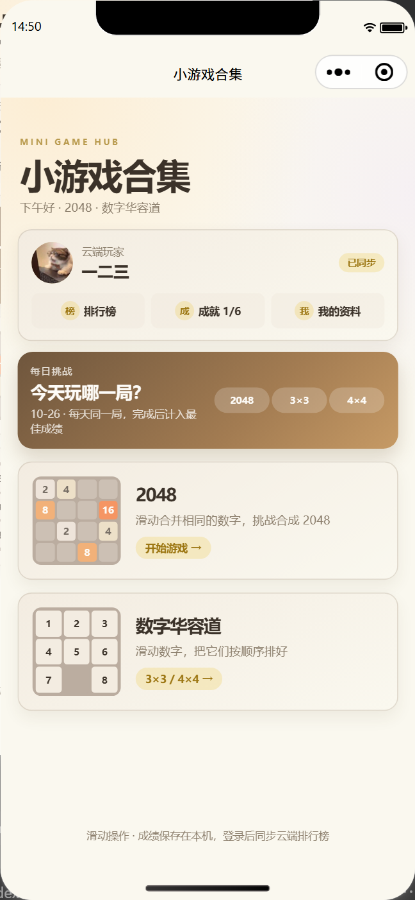
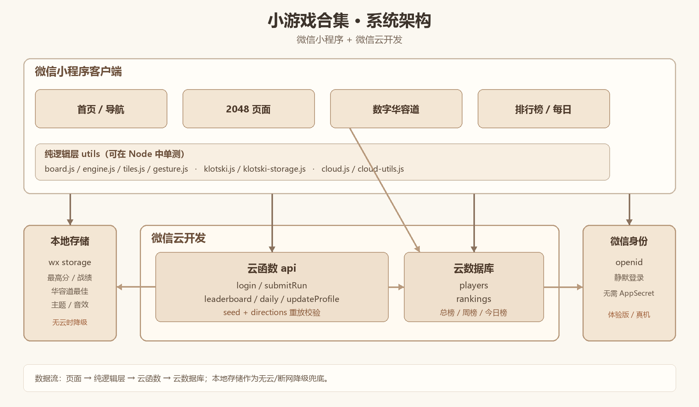
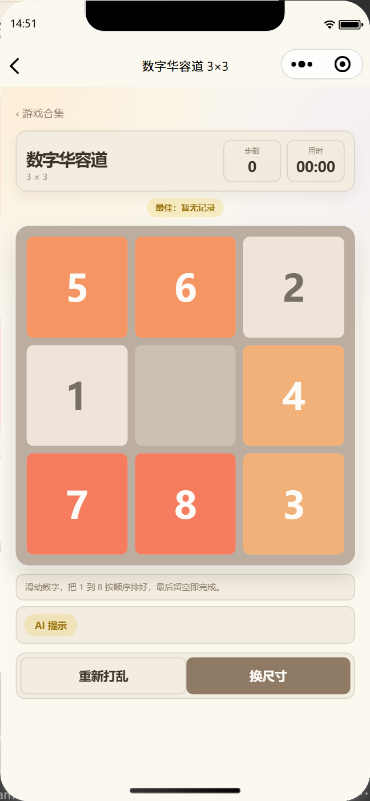
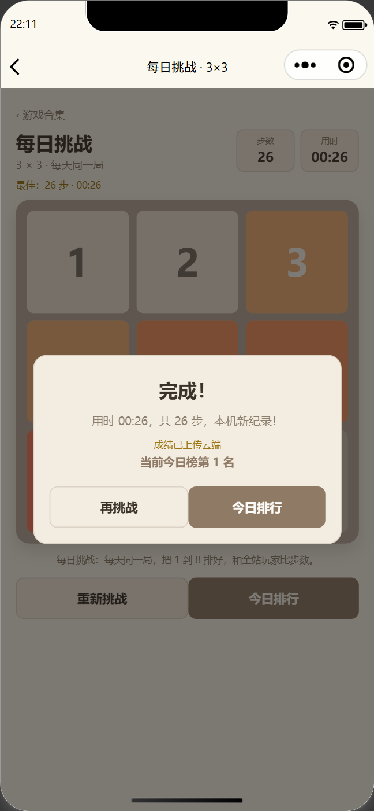

# 小游戏合集（2048 + 数字华容道）设计报告

**课程**：HTML5 移动应用开发  
**项目**：小游戏合集：2048 + 数字华容道（微信小程序 + 云开发）  
**组长**：徐翔（学号：35240929）  
**组员**：郭艺博（学号：55240513）  
**日期**：2026 年 10 月

---

## 1. 概述

本项目是一个原生微信小程序，包含 2048 与数字华容道两款游戏，并通过微信云开发提供登录、云端最佳记录、排行榜和每日挑战。设计目标是把“游戏规则、页面交互、云端数据”分层：纯逻辑可独立测试，页面只负责视图与交互，云函数负责身份与成绩校验。

项目最终版本 v1.8.0，包大小 194.2 KB（198,900 字节），云函数 `api` 约 18.1 KB；103 个单元测试、9 项静态检查、真实云在线验证 13/13。



---

## 2. 技术选型

| 层面 | 选型 | 理由 |
| --- | --- | --- |
| 客户端 | 微信小程序原生 WXML/WXSS/JS | 课程允许；无需额外框架；包体小；体验版直接可用 |
| 游戏逻辑 | CommonJS 纯函数模块 | 可在 Node 中单测；与页面解耦 |
| 状态与交互 | Page + setData + 自定义触摸控制器 | 原生、稳定；适配滑动与动画 |
| 云端 | 微信云开发（云函数 + 云数据库） | 无需自建服务器/域名；openid 登录天然可用；课程演示成本低 |
| 云函数 | 单入口 `api` 路由 | 减少部署数量；共享校验/日期逻辑；便于维护 |
| 测试 | Node `node:test` + 静态检查 + `miniprogram-automator` | 覆盖纯逻辑、工程结构、真实模拟器 |
| 工具 | 微信开发者工具 2.02、Node 24、Git | 与课程环境一致 |

> 没有使用 Vue/React 等框架，原因是本项目页面数量少、交互集中，原生小程序更轻；游戏核心逻辑用纯 JS，测试与复用更直接。

---

## 3. 总体架构



### 3.1 分层

| 层 | 模块 | 职责 |
| --- | --- | --- |
| 页面层 | `pages/home`、`pages/index`、`pages/klotski`、`pages/leaderboard` | 渲染、触摸、弹窗、导航、主题 |
| 逻辑层 | `utils/board.js`、`engine.js`、`klotski.js`、`gesture.js`、`tiles.js` | 规则、状态机、可解性、滑动、动画数据 |
| 云客户端 | `utils/cloud.js`、`cloud-utils.js`、`config/cloud.js` | 云初始化、登录、调用云函数、日期/种子/展示 |
| 云函数 | `cloudfunctions/api` | 登录、提交成绩、排行榜、每日挑战、改昵称、重放校验 |
| 数据层 | 本地 wx storage + 云数据库 `players`/`rankings` | 本地最佳/战绩；云端最佳/榜单 |
| 外部 | 微信登录、云开发环境 | openid、云数据库、云函数运行环境 |

### 3.2 关键设计原则

1. **纯逻辑与页面分离**：棋盘/状态机/可解性不依赖 wx，可在 Node 中测试；
2. **单一云函数入口**：`api` 按 `action` 路由，避免多个函数重复代码；
3. **本地优先、云端增强**：云不可用时自动降级，不影响单机游戏；
4. **服务端不信任客户端**：华容道用 seed + directions 重放验证；每日种子服务端生成；
5. **失败可恢复**：所有存储/云调用 try/catch，页面有 loading/error/空态。

---

## 4. 页面与路由

```text
pages/home/index            启动页：云端状态 + 每日挑战 + 游戏入口
├─ pages/index/index        2048
├─ pages/klotski/index      华容道尺寸选择
│  └─ pages/klotski/game/index?size=3|4&daily=1
└─ pages/leaderboard/index  排行榜
```

- `app.json` 注册 7 个页面；首页为启动页；
- 子页面顶部“‹ 游戏合集”使用 `wx.reLaunch` 回首页，有进度时 `wx.showModal` 确认；
- 排行榜通过 query 指定游戏/周期（`?game=klotski3&period=daily`）；
- 每日挑战通过 `daily=1` 进入，页面从云函数获取当天种子。

---

## 5. 模块设计

### 5.1 2048

| 模块 | 职责 |
| --- | --- |
| `utils/board.js` | 4×4 数组、四方向抽线/压缩/合并、随机生成、胜负判断 |
| `utils/engine.js` | 状态机 `playing/won/over`、`applyMove`、`continueAfterWin`、`restartGame`、战绩 |
| `utils/tiles.js` | 棋盘 → 动画 tile、滑动/合并/生成数据、动画时长 |
| `utils/gesture.js` | 触摸开始/结束、方向判定、最小距离、取消/多指/快速连续 |
| `pages/index` | 视图、动画、弹窗、主题/音效、历史、上云 |

设计要点：

- `applyMove` 返回新 state 与动画数据，不修改入参；
- 只有 `moved=true` 才生成新数字；
- 每块每步最多合并一次；
- 胜利先弹窗，`winAcknowledged` 后继续；结束由满盘 + 无可合并判定；
- 页面用动画锁 + 待执行方向队列，避免快速滑动导致状态错乱。

### 5.2 数字华容道

| 模块 | 职责 |
| --- | --- |
| `utils/klotski.js` | 一维棋盘、滑动映射、可解性、打乱、时间/纪录比较 |
| `utils/klotski-storage.js` | 3×3/4×4 本地最佳记录 |
| `pages/klotski/index` | 尺寸选择、最佳记录展示 |
| `pages/klotski/game` | 棋盘、滑动、计时、每日挑战、云端提交 |

设计要点：

- 棋盘 `0` 为空格，目标 `[1..n²-1,0]`；
- 滑动方向 = 数字移动方向：空格 `(r,c)`，下滑取上方、上滑取下方、左滑取右方、右滑取左方；
- 每次只交换空格与一个邻格，不跨行/列；
- 打乱从完成态随机走 200/500 步合法移动，避免立即反向，保证有解；
- 计时从首次有效移动开始；胜利后停止；
- 每日挑战：服务端返回 `dateKey/seed`，客户端用种子打乱同一棋盘。



### 5.3 排行榜与云端

| 模块 | 职责 |
| --- | --- |
| `pages/leaderboard` | 游戏/周期切换、列表、我的最佳/排名、错误/空态 |
| `utils/cloud.js` | 初始化、静默登录、`submitRun/getLeaderboard/getDaily/updateNickname` |
| `cloudfunctions/api` | `login/submitRun/leaderboard/daily/updateProfile` |
| `players` | 用户昵称、各游戏最佳（扁平字段）、总场次 |
| `rankings` | 用户 × 游戏 × 周期一条，用于排序 |

---

## 6. 数据设计

### 6.1 本地存储

| Key | 内容 | 容错 |
| --- | --- | --- |
| `g2048.bestScore.v1` | 2048 最高分 | 非法 → 0 |
| `g2048.theme.v1` | 主题 | 非法 → light |
| `g2048.sound.v1` | 音效 | 非法 → 开启 |
| `g2048.history.v1` | 最近 10 局 | 损坏 → 过滤 |
| `g2048.klotski.best.3.v1` / `.4.v1` | 华容道最佳 | 损坏 → 忽略 |

### 6.2 云数据库

`players`：

```json
{
  "_openid": "微信 openid",
  "nickname": "玩家1234",
  "best2048Score": 4096,
  "best2048Moves": 300,
  "best2048Time": 120000,
  "best3Moves": 30,
  "best3Time": 65000,
  "best4Moves": 120,
  "best4Time": 300000,
  "totalRuns": 8
}
```

`rankings`：

```json
{
  "_openid": "微信 openid",
  "nickname": "玩家1234",
  "game": "2048 | klotski3 | klotski4",
  "periodKey": "all | week:2026-W42 | daily:2026-10-19",
  "score": 4096,
  "moves": 300,
  "timeMs": 120000,
  "dailyKey": "2026-10-19"
}
```

设计说明：

- 最佳记录用扁平字段，避免 CloudBase 在 `best: null` 上合并嵌套对象报错；
- `rankings` 每个用户 × 游戏 × 周期一条，提交时 upsert，只保留更好成绩；
- 排行榜先取最多 300 条，在云函数内排序后按 `page/pageSize` 分页返回（默认 20 条/页），避免必须建复合索引；
- 客户端不直接读写数据库，全部走云函数。

---

## 7. 关键算法

### 7.1 2048 合并

1. 按方向抽取一行/列；
2. 去掉 0，得到紧凑序列；
3. 从左到右，相邻相同则合并为两倍，得分 += 新值，跳过已合并元素；
4. 补 0 回到 4 格；
5. 对四行/列执行，得到新棋盘与动画数据。

复杂度 O(16)，可忽略。

### 7.2 华容道可解性与打乱

- 逆序数：忽略 0，统计前大后小的对数；
- 奇数阶（3×3）：逆序数为偶数 ⇔ 可解；
- 偶数阶（4×4）：`逆序数 + 空格从下往上行号` 为奇数 ⇔ 可解；
- 打乱：从完成态出发，随机选择合法方向、避免立即反向，走 200/500 步；若回到完成态则再走一步；
- 这样生成的棋盘**一定有解**，避免随机排列导致死局。

### 7.3 每日挑战种子

- 服务端按中国时区（UTC+8）取 `YYYY-MM-DD`；
- `seed = FNV1a("klotski3|" + dateKey)`；
- 客户端从云函数获取 `dateKey/seed`，用同一 `shuffleBoard` 生成棋盘；
- 云端不可用时客户端用相同算法本地生成，保证可玩（但不进云榜）。

### 7.4 服务端重放验证

客户端提交：

```json
{
  "game": "klotski3",
  "size": 3,
  "seed": 4026529168,
  "directions": ["left", "up", "..."],
  "timeMs": 26000,
  "daily": true,
  "dailyKey": "2026-10-19"
}
```

云函数：

1. 校验 size/seed/directions/time；
2. 每日挑战先校验日期/种子（防止拿旧棋盘刷榜）；
3. 用同一 `shuffleBoard(size, seededRandom(seed), 200/500)` 生成棋盘；
4. 逐步 `moveBySwipe`，方向非法直接拒绝；
5. 最终必须 `isSolved`，步数必须等于 directions 长度；
6. 通过后更新 `rankings`/`players`，并按当日/总榜计算我的排名。

> 这样即使客户端改步数、改棋盘，也无法通过校验；每日种子由服务端决定，客户端不能自选。

### 7.5 排名规则

- 2048：`score` 降序，同分 `moves` 升序；
- 华容道：`moves` 升序，同步骤 `timeMs` 升序；
- 提交后按当前模式（每日/总榜）计算我的排名；统计时排除自己的旧记录，避免“自己排在自己前面”。

### 7.6 2048 服务端重放

- 客户端每局生成 `seed`，用 `createSeededRandom(seed)` 创建 RNG；
- 初始棋盘、每次移动后的新数字都从同一个 RNG 消耗，保证可复现；
- 客户端记录每个有效移动方向 `directions`；
- 提交 `seed/directions/score/moves/timeMs`；
- 云函数使用同一份 `engine.js / board.js / random.js` 重放，校验最终分数、步数、结束状态；
- 每日 2048 的 seed 由服务端按日期生成，客户端不能指定；
- 这样 2048 从“范围校验”升级为完整重放，与华容道一致。

### 7.7 AI 提示与自动演示

- 3×3：A* + Manhattan 启发式，返回最优方向序列；页面显示“建议：向下滑（最少 24 步）”；
- 4×4：打乱时记录实际走步，逆序反向即“打乱棋盘 → 完成态”的保证解；用户已走步时先反向撤销用户步数再接保证解；路径较长（>80 步）时自动演示先二次确认；
- 提示按钮按需计算，不阻塞棋盘；计算完成显示下一步方向与步数；
- 3×3 支持“自动演示”，按 320ms 间隔执行解序列，用户触摸可随时打断；
- 求解器与游戏共用 `klotski.js` 的方向语义，避免两套规则。

### 7.8 成就、分页与每日扩展

- 成就：`first_2048`、`first_3x3`、`first_4x4`、`daily_1`、`speed_3`、`score_4096`；云函数在成绩校验通过后解锁，存入 `players.achievements`；
- 首页显示“成就 X/6”，点击查看全部成就与解锁状态；完成弹窗显示新解锁成就；
- 排行榜分页：云函数取最多 300 条后排序，按 `page/pageSize` 返回，页面支持“加载更多”；
- 每日挑战扩展为 2048 / 3×3 / 4×4 三个种子，首页三选一，每日挑战只保留玩法，不生成今日排行榜。

### 7.9 我的资料与自定义昵称

- 新增 `pages/profile/index`：昵称输入、最佳成绩、6 个成就、分享挑战、清空云端记录；
- 昵称校验：2–12 个字符，去除首尾空格，不允许换行/尖括号，由云函数 `updateProfile` 再次校验；
- 新玩家默认昵称“玩家 + 4 位数字”，`nicknameSet=false`，首页显示“点击设置昵称”提示；
- 保存后同步更新 `players.nickname`、`nicknameSet=true` 和该玩家所有 `rankings.nickname`；
- 清空云端记录调用 `resetMyData`，删除该 openid 的 `players` 与 `rankings` 文档，二次确认后执行；
- 首页 `onShow` 重新读取本地缓存的 player，保证从资料页/游戏页返回时昵称、成就数即时刷新。

### 7.10 4×4 保证解与云端存档

- 4×4 打乱时记录实际走步 `applied`，其逆序反向 `opposite` 就是“打乱棋盘 → 完成态”的保证解；
- 用户已经移动后，先反向撤销用户步数，再接打乱逆序，仍是一条合法解；
- 4×4 提示显示“保证解，共 N 步，非最优”；路径超过 80 步时，自动演示先二次确认，避免长时间占用；
- 云端存档保存在 `players.savedGame`（单槽位，最新一局），动作 `saveState/loadState/clearState`；
- 客户端在华容道/2048 的 `onHide` 保存，首页显示“继续上局”，进入后恢复棋盘、步数、分数、计时；
- 保存时记录 `lastSavedMoves`，没有新步不重复保存，避免从“继续上局”退出时旧存档覆盖新游戏；
- 每日挑战存档带 `dailyKey`，跨天自动丢弃并开新局。

### 7.11 首次进入建档与玩家资料

- 新增 `pages/onboarding/index`：6 个内置 emoji 头像、2–12 字昵称、男生/女生/保密三选一；
- 新玩家 `profileCompleted=false`，首页登录后、或直接进入 2048/华容道时都会引导到建档页；
- 保存调用 `updateProfile`，写入 `nickname/nicknameSet/profileCompleted/gender/avatar`，并同步排行榜昵称；
- 支持“先随便逛逛”，本地记录跳过标记，之后可在“我的资料”补档案；
- 首页显示头像、昵称、时段问候；资料页可再次修改头像/昵称/性别；
- **入口纠正**：二维码/冷启动直接落在 2048 时（页面栈只有 1 层且无 daily/resume/share/standalone 参数）自动 `reLaunch` 首页；从首页点 2048 才进入游戏；
- 头像默认用内置 emoji 备选，也支持 `open-type="chooseAvatar"` 直接选择微信头像，上传云存储后以 `avatarUrl` 保存；首页、资料页、排行榜统一显示。

### 7.12 微信头像、总榜默认与最佳修复

- 头像：`chooseAvatar` → `wx.cloud.uploadFile` → 保存 fileID；用户不授权时仍可使用 6 个内置头像；
- 排行榜默认打开**总榜**；只有总榜/本周两个周期，每日挑战不生成今日排行榜；
- 最佳比较：华容道 `moves<=0` 的旧脏数据视为无记录，避免“0 步 + 35 秒”永远压住新成绩；
- 提交成功后客户端用返回的 `best` 更新本地 player，资料页不再显示旧最佳；
- 资料页重新登录拉取最新 player，而不是只读内存缓存。

---

## 8. 交互与视觉设计

- 滑动阈值 20–22px；大方向优先；支持触摸取消、多指、快速连续滑动；
- 棋盘区域 `catchtouchmove`，避免带动页面滚动；
- 华容道数字用 4 组主题色区分区间；3×3/4×4 字号分别适配；
- 胜利/结束/确认使用统一自定义弹窗，避免原生弹窗阻断动画；
- 三套主题通过 CSS 变量切换，导航栏颜色同步；
- 首页用迷你棋盘预览 + 云端状态卡 + 每日挑战 banner，信息层级清晰；
- 子页面统一“‹ 游戏合集”返回入口，符合移动端习惯。


---

## 9. 安全与可靠性

| 风险 | 措施 |
| --- | --- |
| 客户端伪造成绩 | 华容道 seed+directions 重放；每日日期/种子服务端校验；2048 范围校验 |
| 客户端直接改数据库 | 客户端不直接读写；全部走云函数；集合默认权限 |
| AppSecret 泄露 | 项目不需要 AppSecret，文档/代码不包含；只用 AppID |
| 本地存储损坏 | 读写 try/catch + 数据校验，非法回退默认值 |
| 云函数/网络失败 | 页面捕获错误，显示提示；游戏继续本地运行 |
| 冷启动慢 | 页面 loading/轮询；每日挑战失败自动切本地种子 |
| 数据无限增长 | `rankings` 每用户每周期一条；`players` 每用户一条 |
| 包体过大 | 运行时无 npm 依赖；`packOptions.ignore` 排除测试/文档/截图/云函数 |

---

## 10. 测试与结果

| 测试 | 内容 | 结果 |
| --- | --- | --- |
| 单元测试 | 2048/华容道规则、存储、手势、云日期/种子/重放/排名 | 103/103 |
| 静态检查 | 文件/路由/事件/WXML/资源/隐私/云函数同步 | 9/9 |
| 编译 | 微信开发者工具 2.02，基础库 3.17.4 | 194.2 KB |
| 云函数 | `api` 部署，云端安装依赖 | 18.1 KB |
| 云在线 | 登录、建档、每日种子、BFS 提交、2048 总榜、云端存档 | 13/13 |
| 2048 模拟器 | 功能 10/10；胜负 7/7 | 通过 |
| 华容道模拟器 | 入口/尺寸/保证解提示/滑动/胜利/记录/确认 | 13/13 |
| 无云降级 | 离线状态、本地每日、错误态 | 6/6 |
| 截图 | 真实模拟器 21 张 | 完成 |

关键测试设计：

- 华容道重放测试用“与打乱算法相同的路径反向”构造合法解，避免依赖外部求解器；
- 每日挑战测试校验日期边界（UTC 15:59/16:00）与种子一致性；
- 2048 测试覆盖 `[2,2,2,2]`、`[2,2,4,0]` 等易错合并；
- 模拟器用 `evaluate` 在页面上下文调用真实方法，避免 `callMethod` 兼容问题。

---

## 11. 部署与运行

### 11.1 小程序

1. 微信开发者工具导入 `2048-miniprogram/`；
2. 使用正式“小程序”AppID；
3. 编译运行。

### 11.2 云开发

1. 云开发控制台开通/创建环境；
2. 环境 ID 写入 `config/cloud.js`；
3. 右键 `cloudfunctions/api` → 上传并部署（云端安装依赖）；
4. 集合 `players`/`rankings` 首次登录自动创建（或手动创建）；
5. 重新编译，首页显示云端玩家。

### 11.3 体验版

- 公众平台 → 版本管理 → 开发版本 v1.8.0 → 选为体验版；
- 添加体验成员；
- 云环境保持有效；免费体验到期前确认续费/停用。

---

## 12. 不足与改进

1. 排行榜最多取前 300 条再分页，用户量更大时需游标分页/复合索引；
2. 2048 仅做范围校验，未做服务端完整重放；
3. 每日挑战目前只有 3×3 华容道，可扩展到 2048/4×4；
4. 无实时对战/好友系统；
5. 云开发为免费体验/基础套餐，长期运行需评估费用；
6. 真机兼容性仍需在 iOS/Android 多机型上继续验证；
7. 可增加成就系统、数据看板、分享挑战码等增强留存。

---

## 13. 总结

项目从单机 2048 扩展为“2048 + 数字华容道 + 云排行榜/每日挑战”的小程序合集。通过纯函数游戏引擎、统一滑动控制、可解性打乱、服务端重放校验和本地降级设计，兼顾了玩法正确性、工程质量与云端演示效果。最终 103 个单元测试、9 项静态检查、真实云在线 13/13、21 张截图，并完成 v1.8.0 上传，具备课程提交与演示条件。


